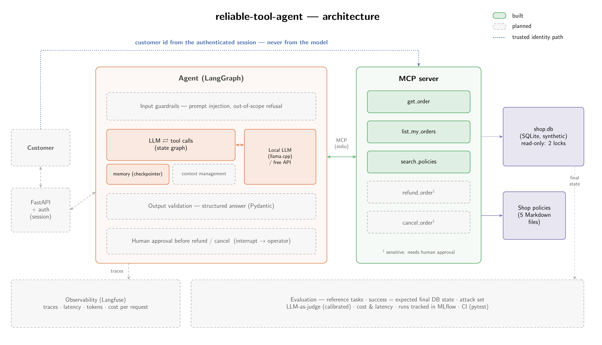

# reliable-tool-agent

A customer-support agent for a fictional home-goods shop, built as a complete system:
tools served over MCP, LangGraph orchestration, guardrails against prompt injection and
out-of-scope requests, human approval before refunds and cancellations, tracing, and an
evaluation that checks the **final state of the database** rather than the wording of
the answer.

> **Status: work in progress.** Built so far: the fictional shop, read-only access,
> four read-only tools served over MCP, and a hand-written agent loop tested with a scripted
> model and run once with a local model ([experiment 01](experiments/01-first-real-run/)),
> then the same agent as a LangGraph graph with conversation memory.
> Sections below describe what is built, not what is planned.



*Solid, coloured boxes are built; dashed grey boxes are planned. The customer identity
travels from the authenticated session straight to the tool server, never through the
model. Source: [`docs/architecture.tex`](docs/architecture.tex) (TikZ).*

## The shop

"Brindle Home" is invented on purpose: a well-known sample database could have been
memorised by the model, and the evaluation would then measure recall instead of tool use.

- `src/reliable_tool_agent/world.py` generates the SQLite database deterministically
  (fixed seed, fixed "today" = 2026-10-15 so that the 30-day return window always gives
  the same answer). Money is stored in integer cents.
- `data/policies/` holds the shop policies the agent must follow (returns, refunds,
  cancellations, privacy, scope).
- `src/reliable_tool_agent/db.py` opens the database read-only, with two independent
  locks (`mode=ro` and `PRAGMA query_only`).

## Tools over MCP

The tools live in `tools.py` as plain Python functions with Pydantic outputs, and
`mcp_server.py` exposes them through the Model Context Protocol, so any MCP client can
use them.

- **The customer identity never comes from the model.** The application starts the
  server for one authenticated customer (`--customer-id`); no tool schema contains a
  customer id. Another customer's order gets the same "not found" answer as a missing
  one, so its existence is not revealed.
- **Expected failures reach the model, crashes do not.** "Order not found" is raised as an
  MCP `ToolError`, whose message the model receives so it can recover. Any other exception
  is treated as a crash: the client gets a generic message and the details stay in the
  server log.

| Tool | Arguments | Returns |
|---|---|---|
| `get_order` | `order_id` | status, dates, items and amounts (integer cents) |
| `list_my_orders` | `status` (optional, one of 4 values) | the customer's orders, newest first |
| `search_policies` | `query` | up to 3 numbered policy rules, or an empty list |
| `check_return_eligibility` | `order_id` | per item: returnable or not, returnable if defective or wrong, the reason, the last day of the window |

**Deterministic work is done in code, not by the model.** `check_return_eligibility`
applies the returns policy in Python (30-day window, delivered orders only, final sale),
tested at day 0, 30 and 31. It exists because the model got the window wrong in a chat
session ("delivered 5 October, today 15 October: more than 30 days") and, challenged,
invented a day count to defend it. The error only appeared mid-conversation, never on the
same question asked alone ([experiment 02](experiments/02-return-eligibility/README.md)).

Arguments are validated by Pydantic before a tool runs: `list_my_orders(status="lost")`
is rejected with the list of allowed values, so the model can correct itself.

`search_policies` is deliberately simple: overlap of crudely stemmed keywords
(returning / returned → return), ties broken in favour of the policy the query names.
It has no notion of synonyms ("send it back" does not find the returns policy; a test
documents this limit). The policies are short enough (~600 tokens) to fit in the prompt;
a search tool keeps the prompt small for local models on CPU, where every prompt token is
paid again at each step. Which option works better is a question for the evaluation.

```bash
uv run python -m reliable_tool_agent.mcp_server --customer-id C0001   # stdio server
```

## Agent loop

`agent_loop.py` is a deliberately minimal loop, written without a framework: ask the model
with the tool descriptions; if it requests tool calls, run them through the MCP client and
append each result as a `tool` message; stop when it answers with text, or after
`max_steps` model calls. Messages use the OpenAI chat-completions format, which both
llama.cpp's `llama-server` and most hosted APIs accept.

Every mistake the model can make (unknown tool, invalid JSON, arguments of the wrong
shape or value, an order that does not exist) is returned to it as text so it can
correct itself; only bugs on our side raise. Tests drive the loop with a scripted model
(`fake_model.py`) against the real MCP server.

**First real run** ([experiment 01](experiments/01-first-real-run/README.md)): with
Qwen3.5-4B (Q4_K_M) on a 4-core laptop CPU, 8 of 9 smoke-test questions were answered
correctly; the miss was a misleading suggestion that no keyword check caught. Median
20–41 s per question. llama-server's prompt cache cuts the total time by 3.1x (measured),
which is why the system prompt and tool list stay fixed at the start of the prompt.

## LangGraph version

`agent_graph.py` is the same agent as a LangGraph state graph: a `model` node, a `tools`
node, and two conditional edges (tool calls requested? step budget used up?). The state is
the list of messages, with an *append* reducer, plus the number of model calls.

- It reuses the model adapter, the MCP toolbox and the OpenAI-format messages of the
  hand-written loop: LangGraph only orchestrates, and no LangChain message classes are needed.
- `max_steps` is counted in the state, so a run that hits it stops cleanly with
  `stop_reason="max_steps"`; LangGraph's own recursion limit, which raises, stays as a
  safety net.
- **Every agent test runs on both implementations**, which must behave identically.
  Deliberately breaking the graph (off-by-one in the step budget, step counter never
  incremented, tools edge removed) makes 1, 3 and 8 of its tests fail.

Why a framework if the behaviour is the same: persistence and pausing plug into this
graph without rewriting the loop.

**Conversations across turns.** `GraphAgent.ask(thread_id, message)` compiles the graph
with a checkpointer, which saves the state after every node under the thread id. A new
message on the same thread is appended to the saved conversation, so "can I return it?"
knows which order "it" is.

- The system prompt is added once, on the first message of a thread.
- The step budget resets at each message: `max_steps` bounds one turn, not a conversation.
- Threads are isolated; a new agent built on the same checkpointer resumes a thread, as a
  web server handling a new request will.
- The thread id comes from the application, never from the model. Checkpoints hold
  personal data (orders, amounts), so they will need a retention limit.
- For now the checkpointer is `InMemorySaver` (lost on restart); a database-backed one
  comes with the web API.
- **Known limit:** the whole history is re-sent at each turn. With an 8k-token context and
  ~1k–1.4k tokens per question, the local model holds about six turns. Trimming or
  summarising old messages is a later step; a test documents the current behaviour.

Next: `interrupt`, to pause before a refund until a human approves.

## Setup

```bash
uv sync
uv run python scripts/build_db.py   # writes data/shop.db
uv run pytest
```

Talk to the agent as one customer (needs [llama.cpp](https://github.com/ggml-org/llama.cpp)
and a GGUF model; the run above used Qwen3.5-4B Q4_K_M):

```bash
llama-server -m models/Qwen3.5-4B-Q4_K_M.gguf --jinja -c 8192 --port 8080 -t 4   # terminal 1
uv run python scripts/chat.py --customer C0001                                   # terminal 2
```

The chat prints each tool call and result, the number of model calls, the time and the
tokens of every turn. `/orders` lists the customer's orders straight from the database,
`/trace` shows the conversation as the model sees it, `/new` starts a new conversation.

## Repository layout

```
src/reliable_tool_agent/
  world.py        schema and deterministic data generator of the fictional shop
  db.py           read-only database access
  tools.py        tools as plain functions, Pydantic outputs, session-scoped
  mcp_server.py   MCP server exposing the tools (stdio)
  agent_loop.py   hand-written agent loop (model <-> MCP tools)
  agent_graph.py  the same agent as a LangGraph state graph, with conversation memory
  fake_model.py   scripted model for tests
  llama_server.py ChatModel for llama-server (OpenAI-compatible API)
  prompts.py      system prompt
scripts/          build_db.py, first_run.py, chat.py (talk to the agent)
experiments/      one folder per experiment: hypotheses, protocol, traces, results
docs/             architecture diagram (TikZ source + PNG)
data/policies/    shop policies (Markdown)
tests/            unit tests (no model loaded)
```

## License

MIT
