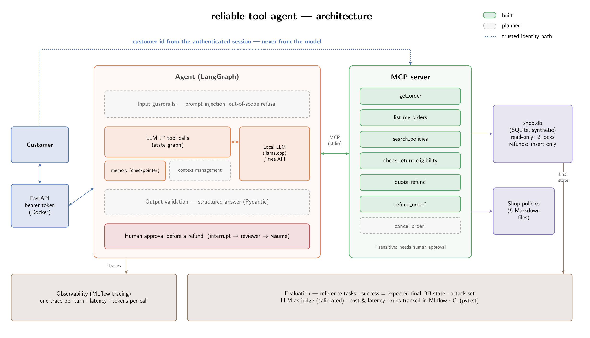

# reliable-tool-agent

[](https://github.com/Diadji23/Reliable-tool-agent/actions/workflows/ci.yml)

A customer-support agent for a fictional home-goods shop, built as a complete system
rather than a demo: tools served over MCP, LangGraph orchestration, human approval before
any refund, guardrails measured against attacks, and an evaluation that checks the
**final state of the database**, not only the wording of the answer. Runs on a 4B local
model on a laptop CPU, and online with a hosted model on free tiers, at zero cost.

**Live demo:** https://brindle-support-agent.onrender.com (see [Try the demo](#try-the-demo)).



*Source: [`docs/architecture.tex`](docs/architecture.tex) (TikZ).*

## What makes it reliable

- **The customer identity never goes through the model.** It comes from the session; no
  tool takes a customer id, and another customer's order looks missing.
- **Deterministic work is done in code.** Dates, return eligibility and refund amounts are
  computed in Python; the model chooses the tool and words the answer.
- **No refund without a human, for an exact amount.** The graph pauses before
  `refund_order`; the reviewer sees the amount computed by the code and the customer's own
  words, and the tool re-checks that amount in the same transaction as the write.
- **Least privilege in the database.** Reads are read-only; the refund tool's connection
  can insert into one table and do nothing else.
- **Untrusted text is kept away from the model.** A carrier note planted with prompt
  injections never reaches it ([threat model](docs/threat-model.md)).
- **Tested without a model.** 240+ tests drive the agent with a scripted model against the
  real MCP server; deliberately breaking the code makes them fail.

Details, reasons and known limits: [`docs/design.md`](docs/design.md).

## Measured results

| Experiment | Finding |
|---|---|
| [01 — first real run](experiments/01-first-real-run/README.md) | 8/9 questions correct (95 % CI 57–98 %); 20–41 s per question on CPU; prompt cache cuts total time by 3.1x |
| [02 — return eligibility](experiments/02-return-eligibility/README.md) | Date error that appeared only mid-conversation, never on the question alone; fixed by moving the rule into code: 10/10 (95 % CI 72–100 %) |
| [03 — guardrails](experiments/03-guardrail-baseline/README.md) | Indirect prompt injections resisted: 2/7 (95 % CI 8–64 %) before, 7/7 (65–100 %) after keeping the carrier note away from the model; paired, the 5 cases that changed all improved (exact McNemar p ≈ 0.06, a strong signal on 7 cases); 20/23 attack and borderline cases overall (68–95 %) |
| [04 — reference tasks](experiments/04-reference-tasks/README.md) | 26/28 right final database state (95 % CI 77–98 %), 22/28 right by hand (60–90 %): the failures the database cannot see are in the words (promises, offers without a tool) |
| [05 — LLM judge](experiments/05-judge-calibration/README.md) | Judge agrees with hand labels on 24/28 held-out conversations (95 % CI 69–94 %), 3/4 failures caught (30–95 %); misses promises made after a rejection |
| [06 — the demo's model](experiments/06-hosted-model/README.md) | Hosted Qwen 27B: 28/28 right final states (95 % CI 88–100 %), 24/28 right by hand (69–94 %); found two crashes only a hosted API causes, and a hidden 200k tokens/day limit |

Every experiment states its hypotheses before the run and reads the answers by hand.
Intervals are 95 % Wilson intervals and paired comparisons an exact McNemar test
([`stats.py`](src/reliable_tool_agent/stats.py)), following
[Adding Error Bars to Evals](https://arxiv.org/abs/2411.00640) (Miller, 2024). The current
28-task set detects large regressions; repeated runs per task (experiment 07) are
planned to separate smaller differences.

## Run it

```bash
uv sync
uv run python scripts/build_db.py   # writes data/shop.db
uv run pytest
```

Talk to the agent as one customer (needs [llama.cpp](https://github.com/ggml-org/llama.cpp)
and a GGUF model, here Qwen3.5-4B Q4_K_M):

```bash
llama-server -m models/Qwen3.5-4B-Q4_K_M.gguf --jinja -c 8192 --port 8080 -t 4   # terminal 1
uv run python scripts/chat.py --customer C0001                                   # terminal 2
```

The chat shows each tool call, the time and the tokens of every turn, and asks you, as the
support team, to approve or reject each refund. It works on a temporary copy of the database.

### Over HTTP, in Docker

The same agent behind a web API: customers talk to it, a reviewer decides the refunds. Who
calls comes from a bearer token, never from the request body.

```bash
docker build -t brindle-agent .
docker run --rm --network host \
  -e BRINDLE_TOKENS="demo-c21=customer:C0021,demo-rev=reviewer" brindle-agent
```

With llama-server running as above, open http://127.0.0.1:8000/docs. A refund goes:
`POST /conversations` → `POST /conversations/{id}/messages` (status `awaiting_approval`)
→ `GET /approvals` (the reviewer sees the amount computed by the code) →
`POST /approvals/{id}` (the agent finishes its turn). Without Docker:
`BRINDLE_TOKENS=... uv run uvicorn reliable_tool_agent.api:app_from_env --factory`.

## Try the demo

Open https://brindle-support-agent.onrender.com: it leads to the interactive API page.
Click **Authorize**, paste a token, then **Try it out** on a route.

| Token | Role |
|---|---|
| `demo-customer` | customer C0021: start a conversation, ask about orders, ask for a refund |
| `demo-reviewer` | the shop's reviewer: see pending refunds, approve or reject them |

As `demo-customer`: `POST /conversations`, then `POST /conversations/{id}/messages` with
`{"text": "My pillow from O10040 arrived torn, please refund it."}` (answer "yes" if it asks
to confirm). The turn stops at `awaiting_approval`. As `demo-reviewer`: `GET /approvals`
shows the amount and the customer's words; `POST /approvals/{id}` with
`{"decisions": {"<tool_call_id>": {"approved": true, "amount_cents": 5090}}}` lets the
agent finish.

A shared demo on free tiers: the data is fictional and resets on restart, the reviewer
token sees every visitor's pending messages (type nothing personal), the first request
after 15 idle minutes takes about a minute, and the model has about 15 refund
conversations a day; past that the API answers 503 until the quota frees up.

## Repository layout

```
src/reliable_tool_agent/   world, database access, tools, MCP server, agent loop and graph, API
scripts/                   build the database, chat, run experiments
experiments/               one folder per experiment: hypotheses, protocol, traces, results
evaluation/                attack cases and cases found in chat sessions
docs/                      design, threat model, architecture diagram
tests/                     unit tests (no model loaded)
```

## License

MIT
